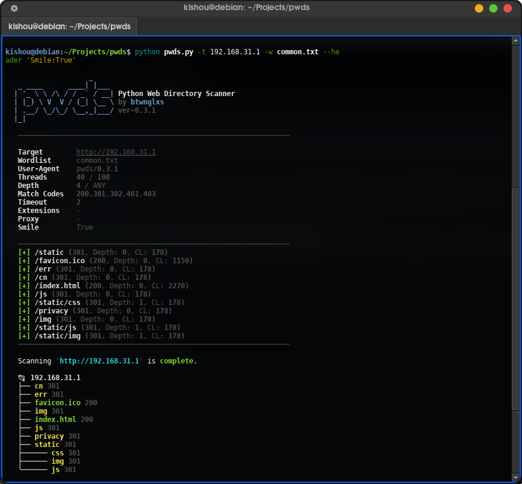

# Python Web Directory Scanner (pwds)

Python Web Directory Scanner (pwds) is a multithreaded, recursive web directory scanner written in Python. It features root directory structure visualization and automatic calibration to filter out false-positive responses.

## Features
- **Recursive Scanning**: Automatically queues discovered subdirectories for further scanning within a specified recursion depth (via the optional `--depth` flag).
- **Auto-Calibration**: Before launching the main scan, the tool sends a deliberately invalid request to measure the `Content-Length` of the "File Not Found" response. This allows it to dynamically filter out false positives (Wildcard/Custom 404s), including protected files like `.ht*` that return a Soft 404.
- **Rich Output**: Uses the `rich` library to deliver a clean, visually appealing terminal user interface.

## Demo


## Usage
```bash
python pwds.py --target 192.168.0.1 --wordlist wordlist.txt [optional flags]
```

Examples:
```bash
python pwds.py --target 192.168.0.1 --wordlist wordlist.txt
python pwds.py --target example.com --wordlist wordlist.txt --depth 8 --match-codes 200,301,500
```

## Options & Flags
```text
--target        Target host or IP address to scan (e.g., 192.168.0.1)
--wordlist      Path to the wordlist file (e.g., wordlist.txt)
--threads       Number of concurrent scanning threads (default: 40, max: 100)
--depth         Maximum recursion depth (default: 2)
--match-codes   Comma-separated list of HTTP status codes to match (default: 200,301,302,401,403)
--extensions    Comma-separated list of extensions to append, e.g., .zip,.bak,.gz,.tar.gz
--no-recursion  Disables recursive scanning entirely
--user-agent    Sets a custom User-Agent header for requests
--proxy         Routes all traffic through the specified proxy URL
--header        Adds a custom HTTP header (Format: "Name: Value") to every request
```

## Installation & Setup

```bash
# 1. Clone the repository
git clone https://github.com/btwnglxs/pwds
cd pwds

# 2. Install required dependencies
pip install -r requirements.txt

# 3. Run the tool
python pwds.py -t 192.168.0.1 -w wordlist.txt
```

> [!IMPORTANT]
> This project is developed strictly for educational and research purposes. The author assumes no liability for any misuse, unauthorized testing, or damage caused by this software.
